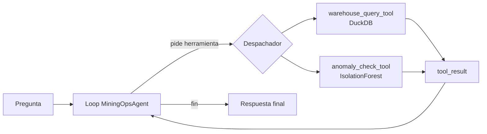
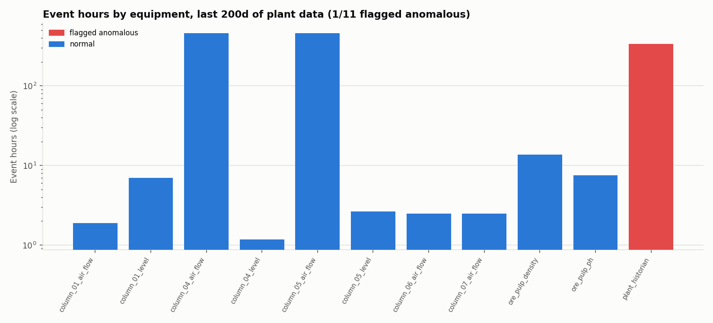
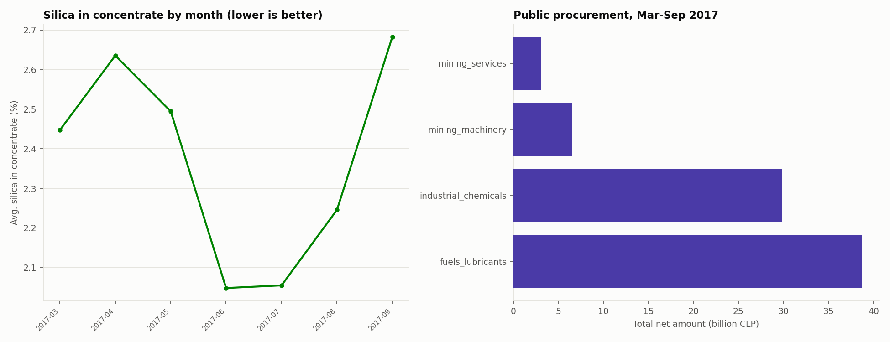

# Chile Mining Ops Agent

*[English version: README.md](README.md)*

[](https://github.com/Rxyxs/chile-mining-ops-agent/actions/workflows/tests.yml)

## Resumen

Un dashboard fijo responde las preguntas para las que se diseñaron sus pantallas. Apenas alguien pregunta algo un poco distinto ("¿cómo estuvo la sílice en junio, y se congeló algún instrumento ese mes?"), hace falta una pantalla nueva o una consulta a mano, y ahí es donde los números se recuerdan mal.

Este repo prueba si un loop de LLM con herramientas lo hace mejor: una interfaz en lenguaje natural que responde más preguntas sin dejar de estar **anclada**. Cada número de una respuesta tiene que venir de una llamada real a una herramienta (una consulta DuckDB, un Isolation Forest), no de lo que el modelo supone. El modelo puede pedir una herramienta, pero no puede inventar un `tool_result`.

Todo lo que tocan las herramientas son **datos públicos reales**:

- **Flotación:** una planta de flotación inversa de mineral de hierro (Kaggle "Quality Prediction in a Mining Process", lecturas cada 20 segundos y análisis de laboratorio horarios, marzo a septiembre de 2017), promediada por día.
- **Eventos de equipos:** detectados en esos mismos datos de planta. Un `stuck_sensor` es un instrumento de proceso que repite exactamente el mismo valor de 20 segundos durante al menos una hora; un `historian_freeze` son cinco o más instrumentos congelados desde la misma hora (el sistema de datos sosteniendo sus últimos valores); un `data_gap` son horas que faltan en el historiador.
- **Compras:** órdenes de compra públicas chilenas (datos abiertos de ChileCompra / Mercado Público) en cuatro categorías relevantes para minería, en los mismos meses: 70.742 órdenes de 856 compradores públicos y 3.931 proveedores.

El agente se corrió de verdad: 100 consultas etiquetadas contra **Qwen2.5-3B-Instruct corriendo local en CPU**, sin API key (resultados más abajo).

## Arquitectura



El loop vive en `src/agent.py` (`MiningOpsAgent`). Envía el mensaje del usuario y los esquemas de las herramientas al modelo; si la respuesta pide una herramienta, llama a la función de Python correspondiente, envuelve el resultado (o la excepción) como `tool_result` y lo devuelve, hasta 5 iteraciones. `agent.run(pregunta)` no guarda estado; `agent.chat(pregunta)` mantiene el historial de varios turnos.

El cliente es cualquier endpoint compatible con OpenAI: OpenAI mismo, o un modelo local servido con llama-cpp-python. El servidor local devuelve los bloques `<tool_call>` de Qwen como texto plano, así que `src/local_client.py` los convierte en `tool_calls` estándar y el agente corre sin cambios.

## Herramientas (`src/tools/`)

| Herramienta | Qué hace |
|---|---|
| `get_flotation_summary(month)` | Días y horas con datos, hierro promedio en alimentación y concentrado, sílice promedio en concentrado, horas con sílice alta (sobre 4,14%, el P90 de la planta), toneladas de pulpa. |
| `get_maintenance_alerts(days)` | Eventos de equipos e instrumentos en los últimos N días de datos de planta (los datos terminan el 2017-09-09), los más graves primero. |
| `get_procurement_summary(status, category, month)` | Cantidad, total, promedio y mediana de órdenes de compra públicas, en millones de CLP. |
| `check_maintenance_anomalies(days, contamination)` | Isolation Forest sobre la cantidad de eventos, las horas de evento y la gravedad de cada equipo. |

Todas son consultas fijas, con nombre y parámetros: no hay entrada para SQL arbitrario. El almacén (`data/ops.duckdb`, 2 MB) lo construye `src/setup_data.py` desde las descargas y está versionado, así que los tests y las herramientas corren desde un clon limpio.

## Resultados

### El agente, medido: 100 consultas, Qwen2.5-3B local

`src/eval_queries.py` tiene 100 consultas en español, cada una con las herramientas y argumentos que debe usar una respuesta correcta: 25 de flotación (5 piden meses sin datos), 12 de alertas, 25 de compras, 10 de anomalías, 16 que necesitan dos herramientas y 12 fuera de alcance donde no debe usarse ninguna. `src/eval_harness.py` puntúa tres cosas por consulta:

- **Herramienta:** se llamaron exactamente las herramientas esperadas.
- **Argumentos:** se llamaron con los valores esperados (mes, estado, categoría, ventana).
- **Anclaje:** cada número de la respuesta aparece, por valor, en un resultado de herramienta, en la pregunta o en la descripción de las herramientas.

| | Corrida 1: montos en pesos | Corrida 2: montos en millones de CLP |
|---|---:|---:|
| Herramienta correcta | 99/100 | 99/100 (IC 95% 95–100%) |
| Argumentos correctos | 95/100 | 96/100 (IC 95% 90–98%) |
| Respuestas ancladas | 67/100 | **86/100** (IC 95% 78–91%) |
| … consultas de compras | 4/25 | **19/25** |
| … consultas de dos herramientas | 8/16 | 12/16 |

Cerca de 32 minutos por corrida en CPU. Tres hallazgos:

1. **El problema no es elegir la herramienta, es copiar los números.** El modelo de 3B elige la herramienta correcta 99 de 100 veces y los argumentos correctos 95 a 96. Con montos en pesos (`965616295`), los copió mal en 21 de 25 respuestas de compras: errores de ×10, separadores de miles corridos, hasta "COP" en vez de CLP. Devolver los mismos montos en millones de CLP (`965.62`) subió las respuestas ancladas de compras de 4 a 19 de 25 sin tocar el modelo. El formato de salida de la herramienta es parte del prompt.
2. **Para meses sin datos, el modelo responde sobre otro mes.** Preguntado por diciembre de 2016 o enero de 2018, llamó a la herramienta con marzo de 2017 y reportó esos números sin decirlo. El chequeo de argumentos lo detecta (esperaba `2016-12`, recibió `2017-03`); el de anclaje no, porque los números son reales.
3. **El anclaje revisa números, no etiquetas.** El modelo a veces reporta 720 *horas* con datos como "720 días". Cada número viene de un resultado de herramienta, así que el chequeo pasa. Es un chequeo necesario, no suficiente.

El primer puntaje daba 38% de respuestas ancladas, pero la mayor parte era el chequeo, no el modelo: comparaba números como texto (`83,678` ≠ `83678.0`) y no contaba el umbral de 4,14% escrito en la descripción de la herramienta. Ahora compara valores, acepta redondeo y cuenta la pregunta y las descripciones como fuentes; `tests/test_local_client.py` cubre esos casos.

El adaptador también tenía un error que vale la pena contar: Qwen envuelve las llamadas como `{{...}}` y a veces deja llaves de cierre de más, y el primer parser descartó 16 de esas llamadas como texto. Ahora lee el primer objeto JSON completo. La corrida 1 de la tabla es posterior a ese arreglo.

### `check_maintenance_anomalies`: el Isolation Forest no ve los peores sensores



En los 200 días de la planta, 11 equipos tienen eventos. Los dos instrumentos de flujo de aire de las columnas 04 y 05 quedaron congelados en el mismo valor durante **460 horas** desde el 10 de marzo, los peores eventos de los datos. El Isolation Forest no marca ninguno: solo marca `plant_historian` (7 eventos, 336 horas). Con 11 puntos y `contamination=0.1` marca un equipo, y dos atípicos idénticos se hacen ver normales entre sí. En estos datos una regla simple (cualquier evento de más de 24 horas) encuentra los dos; el bosque solo se justifica con muchos más equipos que los de una planta de 7 columnas.

### Flotación y compras



Izquierda: sílice mensual en el concentrado (menos es mejor), de 2,64% en abril a 2,05% en junio y julio, y de vuelta a 2,68% en el septiembre parcial. Derecha: compras públicas en las cuatro categorías, marzo a septiembre de 2017. Combustibles y lubricantes (38.700 millones de CLP) y productos químicos industriales (29.800 millones) superan con creces a la maquinaria minera (6.500 millones) y a los servicios de perforación minera (3.000 millones).

```text
>>> get_flotation_summary("2017-06")
{'n_days': 30, 'hours_with_data': 720, 'avg_iron_feed_pct': 58.12, 'avg_iron_concentrate_pct': 65.29,
 'avg_silica_concentrate_pct': 2.05, 'hours_silica_high': 30, 'ore_pulp_tonnes': 288213.0, 'month': '2017-06'}

>>> get_procurement_summary(category="mining_machinery", month="2017-03")
{'n_orders': 699, 'total_amount_million_clp': 965.62, 'avg_amount_million_clp': 1.38,
 'median_amount_million_clp': 0.12, ...}

>>> get_maintenance_alerts(days=60)   # 9 eventos hasta el 2017-09-09, los más graves primero
{'as_of': '2017-09-09', 'n_events': 9, 'events': [
  {'start': '2017-08-02 08:00', 'equipment_id': 'plant_historian', 'event_type': 'historian_freeze', 'severity': 'medium', 'downtime_hours': 7.73},
  {'start': '2017-07-31 11:00', 'equipment_id': 'ore_pulp_ph', 'event_type': 'stuck_sensor', 'severity': 'medium', 'downtime_hours': 5.1}, ...]}
```

## Instalación

```bash
python -m venv .venv
.venv\Scripts\activate       # PowerShell: .venv\Scripts\Activate.ps1
pip install -r requirements.txt
```

## Uso

1. **Herramientas y tests** funcionan desde un clon limpio (el almacén está versionado):

   ```bash
   pytest
   python -m src.generate_report     # figuras + reports/metrics.json
   ```

2. **Reconstruir el almacén desde los datos crudos** (unos 900 MB de descargas en `data/raw/`; la parte de Kaggle requiere `~/.kaggle/kaggle.json`):

   ```bash
   python -m src.sources
   python -m src.setup_data
   ```

3. **Hablar con el agente** con un modelo local, sin clave:

   ```bash
   pip install "llama-cpp-python[server]==0.3.2" --extra-index-url https://abetlen.github.io/llama-cpp-python/whl/cpu
   python -m llama_cpp.server --model qwen2.5-3b-instruct-q4_k_m.gguf --model_alias local --port 8011
   # PowerShell: $env:LOCAL_LLM_BASE_URL = "http://localhost:8011/v1"
   python -m src.cli "¿Cómo estuvo la sílice en el concentrado en junio de 2017?"
   ```

   O define `OPENAI_API_KEY` para usar OpenAI.

4. **Correr la evaluación** (100 consultas; `--rescore` recalcula el puntaje de una corrida guardada sin llamar al modelo):

   ```bash
   python -m src.eval_harness --base-url http://localhost:8011/v1 --model local --parse-tool-calls \
       --output reports/eval_local_qwen2.5-3b.json
   ```

## Limitaciones

- La planta es una planta anónima de mineral de hierro (los datos de Kaggle no la nombran), no una planta chilena de cobre. Las compras son de compradores públicos chilenos, no las compras propias de una minera: Codelco y las mineras privadas no compran por Mercado Público.
- No hay recuperación: el dataset no trae ley de relave, así que la recuperación metalúrgica no se puede calcular.
- La detección de eventos es una regla (valores idénticos durante una hora o más), no una bitácora de mantención. Un tag que un operador fija a propósito también cuenta como congelado.
- Un solo modelo local de un solo tamaño. Los resultados de modelos más grandes o en la nube pueden ser distintos, y el harness corre contra cualquier endpoint compatible con OpenAI para comprobarlo.

## Autor

Pablo Reyes — Data Scientist, Santiago, Chile.
