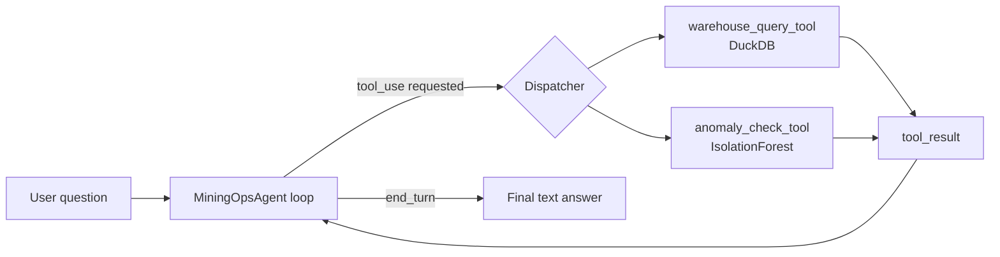

# Chile Mining Ops Agent

[English ] | [[Español](README.es.md) ]

[](https://github.com/Rxyxs/chile-mining-ops-agent/actions/workflows/tests.yml)

## Overview

A fixed dashboard answers the questions its screens were built for. The moment someone asks something slightly off that shape ("how was silica in June, and did any instrument freeze that month?"), you need a new screen or an ad hoc query by hand, and the second is where numbers get misremembered.

This repo tests whether an LLM tool-calling loop does better: a natural-language front end that answers a wider range of questions while staying **grounded**. Every number in an answer has to come from a real tool call (a DuckDB query, an Isolation Forest run), not from the model's guess. The model can request a tool, but it cannot fabricate a `tool_result`.

Everything the tools touch is **real public data**:

- **Flotation:** an iron-ore reverse flotation plant (Kaggle "Quality Prediction in a Mining Process", 20-second readings and hourly lab assays, March to September 2017), averaged by day.
- **Equipment events:** detected in that same plant data. A `stuck_sensor` is a process instrument repeating exactly the same 20-second value for at least an hour; a `historian_freeze` is five or more instruments freezing from the same hour (the data feed holding its last values); a `data_gap` is hours missing from the historian.
- **Procurement:** Chilean public purchase orders (ChileCompra / Mercado Público open data) in four mining-relevant categories, same months: 70,742 orders from 856 public buyers and 3,931 suppliers.

The agent has been run for real: 100 labeled queries against **Qwen2.5-3B-Instruct running locally on CPU**, with no API key (results below).

## Architecture



The loop lives in `src/agent.py` (`MiningOpsAgent`). It sends the user message and the tool schemas to the model; if the response asks for a tool, it dispatches to the matching Python function, wraps the result (or the exception) as a `tool_result`, and sends it back, up to 5 iterations. `agent.run(question)` is stateless; `agent.chat(question)` keeps multi-turn history.

The client is any OpenAI-compatible endpoint: OpenAI itself, or a local model served by llama-cpp-python. The local server returns Qwen's `<tool_call>` blocks as plain text, so `src/local_client.py` parses them into standard `tool_calls` and the agent runs unchanged.

## Tools exposed (`src/tools/`)

| Tool | What it does |
|---|---|
| `get_flotation_summary(month)` | Days and hours with data, average iron in feed and concentrate, average silica in concentrate, hours with high silica (above 4.14%, the plant's P90), ore pulp tonnes. |
| `get_maintenance_alerts(days)` | Equipment and instrument events in the last N days of plant data (the plant data ends 2017-09-09), most severe first. |
| `get_procurement_summary(status, category, month)` | Count, total, average and median amount of public purchase orders, in millions of CLP. |
| `check_maintenance_anomalies(days, contamination)` | Isolation Forest over per-equipment event counts, event hours and severity mix. |

All are fixed, named, parameterized queries: there is no arbitrary SQL entry point. The warehouse (`data/ops.duckdb`, 2 MB) is built from the raw downloads by `src/setup_data.py` and committed, so tests and tools run from a clean clone.

## Results

### The agent, measured: 100 queries, local Qwen2.5-3B

`src/eval_queries.py` holds 100 Spanish queries, each labeled with the tools and arguments a correct run must use: 25 flotation (5 ask for months with no data), 12 alerts, 25 procurement, 10 anomaly checks, 16 that need two tools, and 12 out of scope where no tool should fire. `src/eval_harness.py` scores three things per query:

- **Tool selection:** exactly the expected tools were called.
- **Arguments:** the expected tools were called with the expected values (month, status, category, window).
- **Groundedness:** every number in the answer appears, by value, in a tool result, in the question, or in the tool descriptions.

| | Run 1: amounts in pesos | Run 2: amounts in millions of CLP |
|---|---:|---:|
| Correct tools | 99/100 | 99/100 (95% CI 95–100%) |
| Correct arguments | 95/100 | 96/100 (95% CI 90–98%) |
| Grounded answers | 67/100 | **86/100** (95% CI 78–91%) |
| … procurement queries | 4/25 | **19/25** |
| … two-tool queries | 8/16 | 12/16 |

About 32 minutes per run on CPU. Three findings:

1. **Tool choice is not the problem; copying numbers is.** The 3B model picks the right tool 99 times in 100 and the right arguments 95 to 96 times. With amounts in raw pesos (`965616295`), it miscopied them in 21 of 25 procurement answers: ×10 slips, misplaced thousands separators, even "COP" instead of CLP. Returning the same amounts in millions of CLP (`965.62`) raised grounded procurement answers from 4 to 19 of 25 without touching the model. The tool's output format is part of the prompt.
2. **For months with no data, the model answers about a different month.** Asked for December 2016 or January 2018, it called the tool for March 2017 and reported those numbers without saying so. The argument check catches it (expected `2016-12`, got `2017-03`); groundedness does not, because the numbers are real.
3. **Groundedness checks numbers, not labels.** The model sometimes reports 720 *hours* with data as "720 days". Every number traces back to a tool result, so the check passes. It is a necessary check, not a sufficient one.

The first scoring pass gave 38% grounded, but most of that was the checker, not the model: it compared numbers as strings (`83,678` ≠ `83678.0`) and did not count the 4.14% threshold written in the tool description. The checker now compares values, accepts rounding, and counts the question and tool descriptions as sources; `tests/test_local_client.py` covers those cases.

The adapter also had a bug worth noting: Qwen wraps calls as `{{...}}` and sometimes leaves extra closing braces, and the first parser dropped 16 such calls as plain text. It now reads the first complete JSON object. Run 1 in the table is after that fix.

### `check_maintenance_anomalies`: the Isolation Forest misses the worst sensors


Over the plant's 200 days, 11 equipment items have events. The two air-flow instruments of columns 04 and 05 were frozen on the same value for **460 hours** from 10 March, the worst events in the data. The Isolation Forest flags neither: it flags only `plant_historian` (7 events, 336 hours). With 11 points and `contamination=0.1` it flags one item, and two identical outliers make each other look normal. On this data a simple rule (any single event over 24 hours) finds both; the forest earns its place only with many more equipment items than a 7-column plant has.

### Flotation and procurement


Left: monthly silica in concentrate (lower is better), from 2.64% in April down to 2.05% in June and July, and back up to 2.68% in the partial September. Right: public procurement in the four categories, March to September 2017. Fuels and lubricants (38.7 billion CLP) and industrial chemicals (29.8 billion) dwarf mining machinery (6.5 billion) and mining drilling services (3.0 billion).

```text
>>> get_flotation_summary("2017-06")
{'n_days': 30, 'hours_with_data': 720, 'avg_iron_feed_pct': 58.12, 'avg_iron_concentrate_pct': 65.29,
 'avg_silica_concentrate_pct': 2.05, 'hours_silica_high': 30, 'ore_pulp_tonnes': 288213.0, 'month': '2017-06'}

>>> get_procurement_summary(category="mining_machinery", month="2017-03")
{'n_orders': 699, 'total_amount_million_clp': 965.62, 'avg_amount_million_clp': 1.38,
 'median_amount_million_clp': 0.12, ...}

>>> get_maintenance_alerts(days=60)   # 9 events up to 2017-09-09, most severe first
{'as_of': '2017-09-09', 'n_events': 9, 'events': [
  {'start': '2017-08-02 08:00', 'equipment_id': 'plant_historian', 'event_type': 'historian_freeze', 'severity': 'medium', 'downtime_hours': 7.73},
  {'start': '2017-07-31 11:00', 'equipment_id': 'ore_pulp_ph', 'event_type': 'stuck_sensor', 'severity': 'medium', 'downtime_hours': 5.1}, ...]}
```

## Installation

```bash
python -m venv .venv
.venv\Scripts\activate       # Windows PowerShell: .venv\Scripts\Activate.ps1
pip install -r requirements.txt
```

## Usage

1. **Tools and tests** work from a clean clone (the warehouse is committed):

   ```bash
   pytest
   python -m src.generate_report     # figures + reports/metrics.json
   ```

2. **Rebuild the warehouse from the raw data** (about 900 MB of downloads into `data/raw/`; the Kaggle part needs `~/.kaggle/kaggle.json`):

   ```bash
   python -m src.sources
   python -m src.setup_data
   ```

3. **Talk to the agent** with a local model, no key needed:

   ```bash
   pip install "llama-cpp-python[server]==0.3.2" --extra-index-url https://abetlen.github.io/llama-cpp-python/whl/cpu
   python -m llama_cpp.server --model qwen2.5-3b-instruct-q4_k_m.gguf --model_alias local --port 8011
   # PowerShell: $env:LOCAL_LLM_BASE_URL = "http://localhost:8011/v1"
   python -m src.cli "¿Cómo estuvo la sílice en el concentrado en junio de 2017?"
   ```

   Or set `OPENAI_API_KEY` instead to use OpenAI.

4. **Run the evaluation** (100 queries; `--rescore` recomputes the scores of a saved run without calling the model):

   ```bash
   python -m src.eval_harness --base-url http://localhost:8011/v1 --model local --parse-tool-calls \
       --output reports/eval_local_qwen2.5-3b.json
   ```

## Limitations

- The plant is an anonymous iron-ore plant (the Kaggle data does not name it), not a Chilean copper plant. Procurement is Chilean public buyers, not a mining company's own purchasing: Codelco and private miners do not buy through Mercado Público.
- There is no recovery figure: the dataset has no tailings assay, so metallurgical recovery cannot be computed.
- Event detection is a rule (identical values for an hour or more), not a maintenance log. A tag held on purpose by an operator also counts as stuck.
- One local model at one size. Results for larger or hosted models may differ, and the harness runs against any OpenAI-compatible endpoint to check that.

## Author

Pablo Reyes — Data Scientist, Santiago, Chile.
